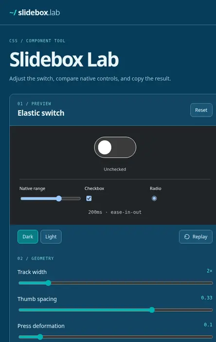

# Slidebox Lab

An elastic CSS switch with a playground for geometry, colors, and motion.

[Preview the interactive playground online](https://htmlpreview.github.io/?https://github.com/monabbous/slidebox/blob/master/index.html)



The animation uses the default width (2), thumb spacing (0.33), deformation (0.1), and a 200ms `ease-in-out` transition.

## Run locally

Clone this repository, then serve its root directory:

```bash
python3 -m http.server 8080
```

Open `http://localhost:8080`. The lab uses plain HTML, CSS, and JavaScript, without a build step.

## Playground

- Adjust track width, thumb spacing, press deformation, and transition duration.
- Change easing family and direction (In, Out, or In-Out), including Elastic and Bounce.
- Compare Slidebox against native controls in light and dark schemes.
- Choose browser-default, CSS system, nabous.dev, or custom colors.
- Copy complete CSS, Tailwind v4 `@utility` CSS, or configuration variables.

Controls can be adjusted without triggering transition animations. The selected duration is restored after two animation frames.

The easing functions follow [easings.net](https://easings.net/). Elastic and Bounce use sampled CSS `linear()` timing functions.

## Original Slidebox package

The original Sass package, compiled CSS, package manifests, and example are preserved in [`legacy/`](legacy/). See the [legacy README](legacy/README.md) for the previous installation instructions.

[Source](https://github.com/monabbous/slidebox) · [nabous.dev](https://nabous.dev)
